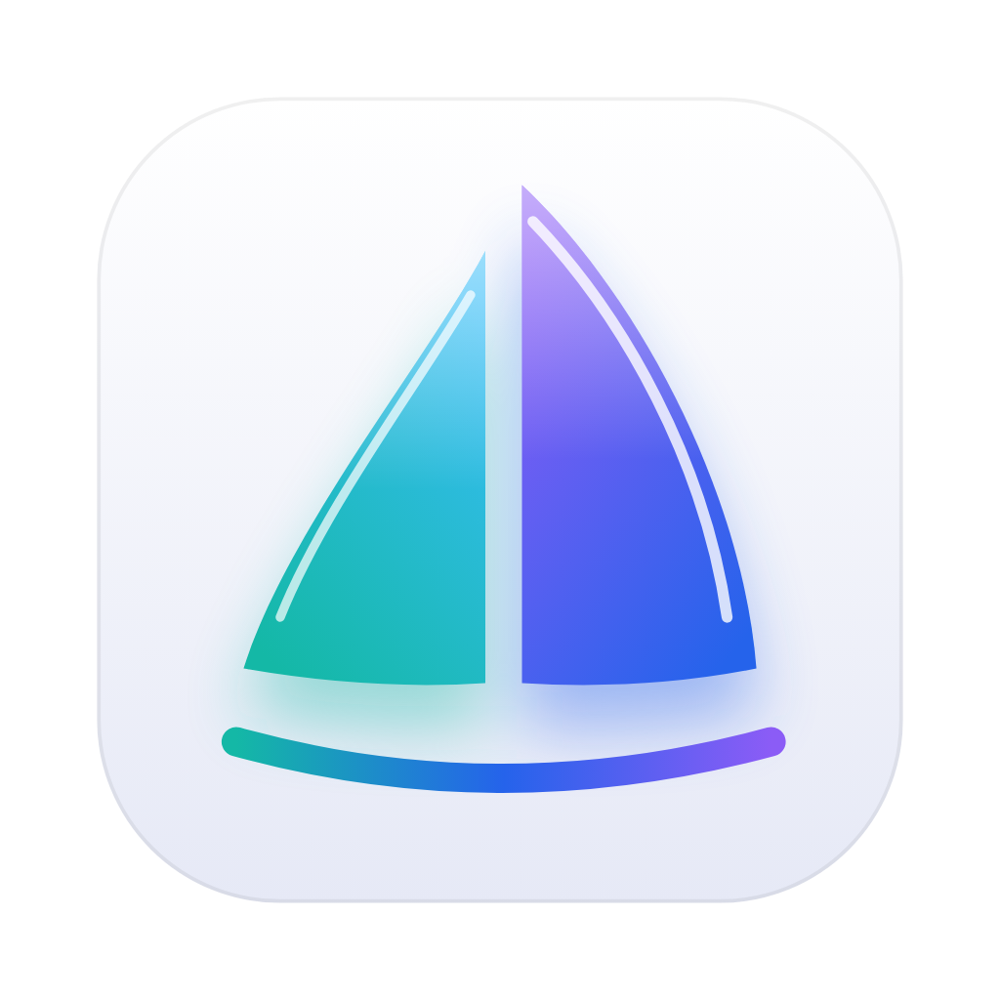

<p align="center"></p>

# Embark

An open-source, Arc-style browser for macOS, built natively in Swift with Liquid Glass and
powered by Chromium.

- **Spaces:** each space has its own tint, its own favorites, its own tabs and its own
  profile, so work and personal logins never mix.
- **Vertical tabs** in a sidebar that sits on the window's tint, not in a separate box.
- **Command bar** (⌘T): switch tabs, open favorites or pages from history, run actions, or
  go to any address or search.
- **Split view** (⌘⇧=): two tabs side by side.
- **Fast:** tabs stay live for instant switching, idle tabs sleep to save memory.

> Status: early. The UI runs on WebKit while the Chromium engine is brought up.
> See [docs/ARCHITECTURE.md](docs/ARCHITECTURE.md).

## Build

Requires macOS 26 and Xcode 26.

```sh
brew install xcodegen
xcodegen generate
open Embark.xcodeproj
```

That builds the `Embark` scheme, which uses WebKit and needs no downloads. To build with
Chromium, run `scripts/fetch-cef.sh` first, then build the `EmbarkChromium` scheme. See
[docs/ARCHITECTURE.md](docs/ARCHITECTURE.md#chromium-via-cef).

### Running the Chromium build day to day

Browse with a Release build (`xcodebuild -scheme EmbarkChromium -configuration Release build`).
Debug builds run Swift and SwiftUI unoptimized and feel noticeably slower.

Xcode signs local builds ad hoc, so every rebuild looks like a new app to macOS and it asks
again for the keychain item that encrypts cookies and saved passwords ("Embark Safe Storage").
To keep the same identity across rebuilds, sign the built app with a local self-signed
identity before running or installing it:

```sh
scripts/sign-local.sh path/to/Embark.app
```

The first run creates an "Embark Local Dev" identity in its own keychain under
`~/Library/Application Support/Embark/Signing` (not your login keychain). Click
"Always Allow" once after that; later rebuilds signed the same way are remembered. CI
doesn't sign and isn't affected.

### Tests

```sh
xcodebuild test -project Embark.xcodeproj -scheme EmbarkTests -destination 'platform=macOS'
```

## Shortcuts

| Action | Shortcut |
| --- | --- |
| Command bar / new tab | ⌘T or ⌘L |
| New window / private window | ⌘N / ⇧⌘N |
| Close tab / reopen closed tab | ⌘W / ⇧⌘T |
| Next / previous tab | ⌃Tab / ⌃⇧Tab |
| Tab 1 to 8 / last tab | ⌘1 … ⌘8 / ⌘9 |
| Find / next / previous | ⌘F / ⌘G / ⇧⌘G |
| History | ⌘Y |
| Copy URL | ⇧⌘C |
| Zoom in / out / actual size | ⌘= / ⌘- / ⌘0 |
| Stop loading | ⌘. |
| Print | ⌘P |
| Developer tools | ⌥⌘I |
| New folder | ⌥⌘N |
| Back / forward / reload | ⌘[ / ⌘] / ⌘R |
| Add to favorites | ⌘D |
| New split (pick the new pane in the command bar) | ⌃⇧= |
| Previous / next pane | ⌃⇧[ / ⌃⇧] |
| Toggle sidebar | ⌘B or ⌘S |
| Next / previous space | ⌘⌥→ / ⌘⌥← |
| Jump to space 1 to 9 | ⌃1 … ⌃9 |

## Contributing

Pull requests are welcome. See [CONTRIBUTING.md](CONTRIBUTING.md) and the
[Code of Conduct](CODE_OF_CONDUCT.md). Report security issues privately, as described in
[SECURITY.md](SECURITY.md).

## License

MIT. See [LICENSE](LICENSE).
